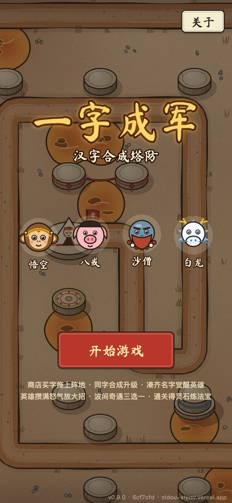
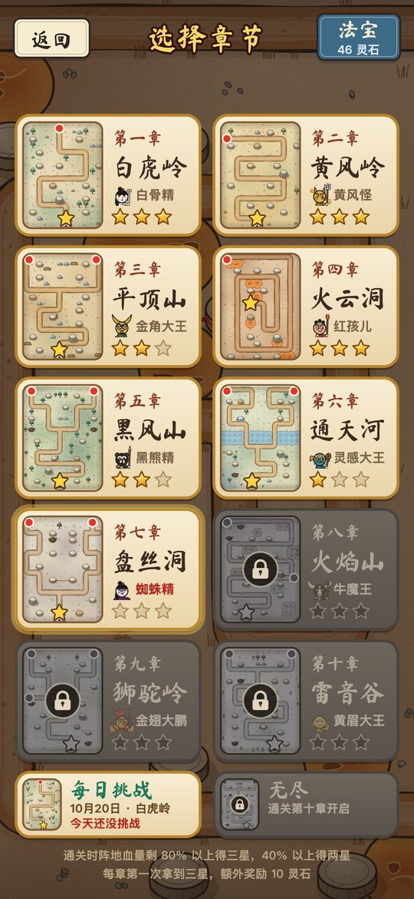
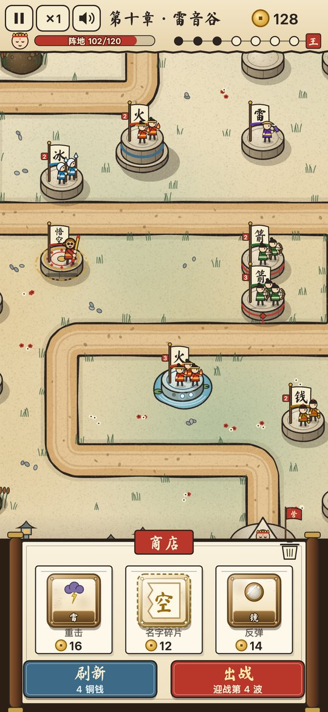
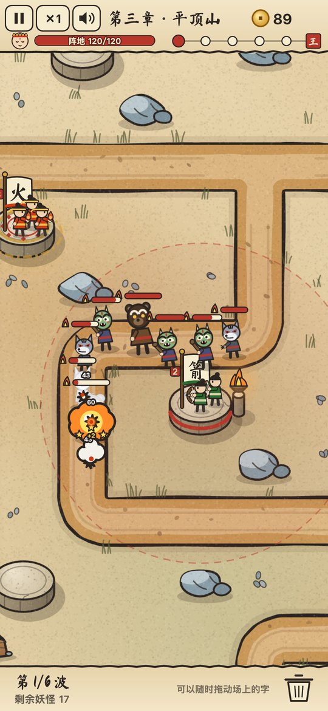
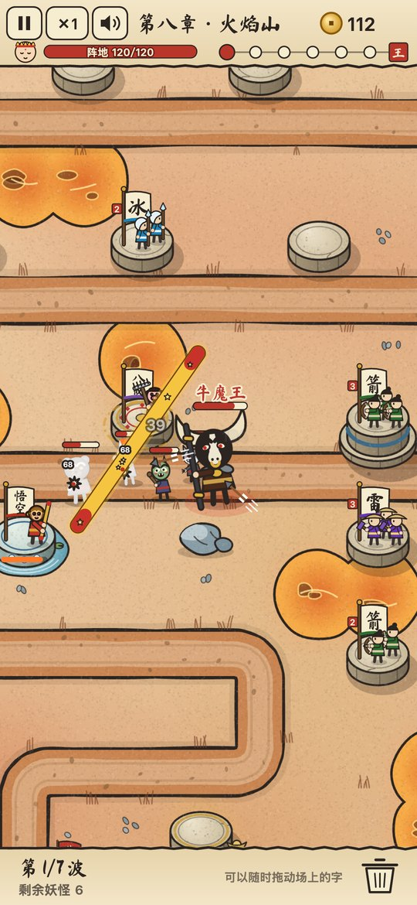

# 一字成军

以字为兵的汉字合成塔防 H5 小游戏，玩法像《王国保卫战》：每章一张手绘地图，妖怪沿着路从城门走向师父的营地，路边有一个个石台，把书法字卡拖到石台上，它就变成一面写着这个字的军旗和一队小兵，这就是一座塔。同字合成升级，凑齐名字觉醒英雄；英雄攒满怒气放大招，波间奇遇三选一，通关拿灵石炼法宝。地图比屏幕大，可以拖动和缩放。纯 Canvas 2D 绘制，运行时零依赖，美术全部由代码画出，音效和音乐全部由 WebAudio 现场合成。

线上地址：https://zidou-xiyou.vercel.app （推 `main` 自动部署；国内网络可能打不开）。首页右下角的浅色小字是版本号、构建提交和当前域名，反馈问题时截图带上。浏览器语言不是中文时显示英文版 **Glyph Legion**（见下面的「英文版」）。英文版也上架了 itch.io：https://priority3.itch.io/glyph-legion （手动上传 `pnpm build:en` 的包，不随 `main` 自动更新）。

<p align="center">
  
  
  
  
  
</p>
<p align="center"><sub>首页 · 选章 · 构筑期（字旗小兵、双生台、灵泉、宣纸商店） · 战斗（脸谱小鬼、点着的烽火台、命中和击败） · Boss 战（牛魔王，悟空的金箍棒扫过）</sub></p>

## 运行

```bash
pnpm install
pnpm dev          # http://localhost:5173
pnpm dev:host     # 手机和电脑连同一个 WiFi，用手机打开终端里显示的 Network 地址
pnpm test         # 单测 + 机器人闯关测试
pnpm sim [局数] [法宝,法宝:阶]   # 机器人打每一章的胜率表，调数值用（默认每章 40 局、不带法宝）
pnpm sim 40 --leaks              # 每章每波平均漏怪，标出第一个崩盘波
pnpm sim --chapter 3 --trace --seed 123   # 重放一局，逐波看出怪、漏怪、阵地血、铜钱和机器人买了什么
pnpm sim --endless 40            # 机器人打无尽模式，平均和最好倒在第几波（加 --trace --seed S 逐波看）
pnpm build        # 类型检查 + 打包到 dist/，可部署到任意静态服务器
pnpm build:en     # 打海外游戏门户用的英文包到 dist-en/（固定英文，见「英文版」）
pnpm preview      # 本地跑打包后的版本，验证安装、离线和新版本提示（离线缓存只在打包后的版本里启用）
pnpm font         # 新增中文文字后，用 fonts/ 里的原字体重新裁剪书法字体子集
```

## 玩法

- **构筑期**：商店有 3 张卡，拖到路边的石台上就是买下；拖到同名同级的卡上，买下后直接合成升级（松开前会有金色转圈提示）。刷新商店要花铜钱，价格递增；点「出战」开打下一波。
- **字旗和小兵**：卡一落到石台上就变成字旗和小兵。一级一个兵、两级两个、三级起三个，四级起兵戴铁盔，两级起旗杆上挂一枚朱砂印写着等级；鎏金后旗子变金色，脚下泛金光。每种字的兵拿自己的家伙：棍兵抡棍、箭兵拉弓、火兵扔火球、冰兵举冰矛、雷兵举锤引雷、毒兵吹毒针、网兵撒网，速兵摇令旗、钱兵提铜钱串、疗兵举葫芦、鼓兵打腰鼓、镜兵举铜镜。兵朝着刚打的妖怪转身，轮流出手，箭、火球这些弹道从出手那个兵的兵器上飞出去。英雄是一个大个子，脑袋就是头像，旗上写着名字；名字碎片和「金」只有一面旗，碎片的旗是撕开的。
- **地图与石台**：妖怪从城门沿路走到营地，走到了就按攻击力扣阵地血量，归零失败。一部分石台开局就能用，其余点一下花铜钱解锁。场上的字随时可以拖动，用来移动、交换、合成、觉醒英雄和鎏金；拖进垃圾桶可以卖掉，返还一半。
- **特殊石台**：法阵让站上去的兵字和英雄伤害 +20%，台面刻着金色和朱砂色的环，地上有金色符文环缓缓转动；高台射程 +30，是更高的石墩，下面垫一圈底座、腰上箍一道石青色的带子；泥沼从第 5 章出现，是一滩长着香蒲的烂泥，放不了兵字和英雄，只能放辅助字、名字碎片和「金」。后来的四种逐章出场：聚宝台从第 2 章起，站在上面的字每击败一只妖怪多得 1 铜钱、Boss 多得 10（看最后一下是谁打的），石墩箍着金边、侧面嵌着方孔钱，脚下堆着元宝；烽火台从第 3 章起，台上放了任何字就点燃旁边石柱上的火盆，130 范围内的妖怪挨所有字的打都多掉 15%（毒的持续伤害不算，两个烽火台不叠加），地上画出范围圈，被照到的妖怪血条边有一小簇火苗；双生台从第 4 章起，总是两个一对、地上连着红绳（地图里按读的顺序两两配对），两台站着同一个兵字或英雄时各加 25% 攻速（不占速和鼓的上限），红绳会亮起金光；灵泉从第 6 章起，石墩立在一汪清水里，站在上面的字每守住一波攒一层，最多 3 层，兵字和英雄每层伤害 +8%，石墩上的珠子一层亮一颗，原地升级、鎏金都保留，一挪走就清零。拖卡悬停时石台上方会写出效果。锁着的石台蒙着一层暗色，上面贴一张纸封条写着解锁价，特殊石台的封条上还写着名字，铜钱不够时价格变成朱砂色。每章至少一个法阵和一个高台，特殊石台不超过五分之二。
- **瞄准**：点一下场上的兵字或英雄看射程和说明，它还选中时再点一下，在打最前、打最强、打最弱之间切换。不是默认模式的卡右下角有角标，王冠是最强，裂开的心是最弱。合成、移动后模式保留。
- **镜头**：开局 1:1 对准起手的字（地图上的卡和商店里的一样大），按住空地拖动平移，双指或滚轮缩放，最远可以缩到整张图。
- **声音**：音效和古筝味的背景音乐都是代码合成的，构筑期舒缓、战斗期加快、Boss 波转小调。HUD 左上的喇叭一键静音，暂停页可以单独关音乐，设置会记住。手机上第一次点屏幕后才会出声（浏览器规定）。
- **局中存档**：每次进入构筑期自动存一份。关掉页面再回来，首页出现「继续上次（第几章 · 第几波）」，回到那一波构筑期的开头；战斗中途退出会从这一波重打。选章页开新局前会确认覆盖；通关、失败、返回选章时存档删除。
- **妖怪**：每只妖怪都是画着京剧脸谱的小鬼，两条腿、一件袍子或一身铠甲，脸谱、头饰和手里的家伙各不相同：小妖绿脸长角扛棒子，狼妖灰脸白嘴竖着尖耳朵，熊怪棕脸圆耳朵，魔将红脸黑角持长枪，盗宝妖蒙着黑眼罩背着钱袋；十个 Boss 多是金脸、白脸、黑脸，白骨精是骷髅妆，金角大王顶一对金角提葫芦，牛魔王一张黑脸配白鼻梁和金鼻环，金翅大鹏背着金翅膀。血条是纸槽里的一道朱砂，Boss 和魔将的名字写在血条上方。
- **妖怪动作**：妖怪朝行进方向转身，走路一压一拉，冲刺时步子加快，眩晕时停下，头顶转着金星；小怪被打败时化成一团白烟，冒出三颗小星星，Boss 倒地淡出，落地震出一圈冲击波；Boss 登场时震屏、四角压暗。暂停时一切静止。
- **特效与界面**：命中处弹出一颗描墨边的白星，火球是带尾巴的橘色火团，炸开成一团描边的橘色烟云；伤害和赏金数字是粗体描墨边，弹出时先放大再回落。顶栏是一条宣纸，下沿一道墨边；商店是一卷两头有木轴的手卷，卡片放在纸签上，标题是一枚朱砂印；暂停、奇遇和结算面板是上下两根木轴的立轴；按钮是描墨边的朱砂、石青和纸色色块。
- **飞行妖怪**：第 6 章起，第 3 波以后的非 Boss 波有 30% 的概率来一队空袭，3 + 波数/2 只蝙蝠精，第 9 章起每隔一只换成鹏雏。它们在地面妖怪出到一半时从城门起飞，直线飞向营地，画在所有地面妖怪上面，身体悬空、地上有影子。棍和八戒砸地够不着它们，箭和雷对空伤害 ×1.3，火的溅射、冰、沙僧、白龙都能打。飞行妖怪不吃击退，悟空的大招只扫地面，八戒、沙僧、白龙的大招都能打到。
- **星级与选章页**：通关按剩余阵地评星，剩 80% 以上三星、40% 以上两星，否则一星。每章第一次拿满三星额外奖励 10 灵石。选章页每张卡片带这一章的地图缩略图，红点是入口、金星是营地，还有 Boss 和最好星级；下一章金框闪烁，未解锁的灰显加锁。首页、选章页、法宝页背后的地图每天轮换一张。
- **无尽与每日挑战**：第 10 章通关后选章页出现「无尽」，用第 10 章的地图和经济，没有最后一波，血量一直涨，每 5 波随机来一个满血 Boss，Boss 之后 2 波来魔将。第 1 章通关后出现「每日挑战」：当天日期就是随机种子，所有人同一局，地图按日期轮换，第 10 章经济，不带法宝。两种模式里一波拖过 150 秒妖怪会狂暴，不再吃眩晕、减速和击退。每撑过一波 2 灵石，结束时一次发放；分别记无尽最佳和当日最佳，破纪录有印章。两种模式都能继续上次，隔天的每日存档作废。
- **战报分享**：结算面板右上角有一枚红色「分享」印章，胜负、无尽、每日都有。点一下生成一张 1080×1920 的战报，有章节或模式、地图、结果和星级、守住的波数、剩余阵地、击败、带的法宝、日期、版本号和网址。手机浏览器支持的话直接弹系统分享；否则全屏显示图片，长按保存或右键另存为，点「关闭」或按 Esc 返回。
- **安装与离线**：手机浏览器「添加到主屏幕」后全屏打开，打开过一次后断网也能玩。发布新版后首页底部出现「有新版本，点此刷新」，点一下切到新版本。
- **启动与关于**：每次打开先显示健康游戏忠告和 12+ 适龄提示，1 秒后点任意处继续，3 秒后自动进入首页（网址带 `#editor` 时跳过）。首页右上角「关于」里有隐私政策、用户协议、适龄提示、健康游戏忠告、版本号和联系邮箱，可以拖动或用滚轮翻看，顶部按钮跳到各节。
- **新手引导**：第一次打第一章时，有一只手演示拖地图、把卡拖到石台、点出战、同名卡叠加，做完一步进下一步，通关后不再出现。
- **字卡**：
  - 兵字：棍（近战）、箭（远程）、火（溅射）、冰（减速）、雷（天雷重击）、毒、网
    - 毒：毒针每中一次叠一层毒，最多 5 层，每层每秒 2 点、持续 4 秒，再中刷新；层伤随等级、鎏金、法宝、法阵和鼓一起涨，不吃护甲，Boss 也吃满，毒死照常给赏金
    - 网：每 4 秒撒一张网，伤害很低，把目标定身 1 秒（能挨打、不能走），Boss 也定满；挣脱后 1 秒内网不住，无尽里妖怪狂暴后网也失效
  - 辅助：速（周围加攻速）、钱（产铜钱）、疗（阵地回血）、鼓、镜
    - 鼓：相邻石台的兵字和英雄每级伤害 +15%、攻速 +10%，伤害最多 +45%，攻速和速合计有上限；和法阵相乘，大招也吃
    - 镜：每 6 秒把这段时间漏怪造成的阵地伤害（最多存 30 点）按等级和本波妖怪血量折算，反弹给全场每只妖怪，飞的也打
  - 名字碎片：悟/空、八/戒、沙/僧、白/龙，两半合在一起觉醒英雄：
    - 悟空：金箍棒贯穿一排
    - 八戒：砸地群晕
    - 沙僧：月牙铲收服残血
    - 白龙：横扫全场
  - 「金」：拖到兵字或英雄上鎏金，变成金X
- **英雄大招**：英雄每次普攻攒 10% 怒气（金X 英雄更快），卡片下方有怒气条，攒满后卡片发光，下一击改放大招：
  - 悟空「金箍棒·横扫」：目标所在那条路上的妖怪全挨一棒并击退
  - 八戒「钉耙·天降」：钉耙从天而降，大范围伤害并长时间眩晕
  - 沙僧「宝杖·连击」：连击射程内血最少的五只，残血直接收服
  - 白龙「龙吟」：全场伤害、击退并减速
- **奇遇**：每清掉第 2、4、6 波，构筑期开始时三选一，选完才能继续买卡/出战：
  - 福缘（立刻生效）：枯木逢春（阵地回满、上限 +10）、招财进宝（+50 铜钱）、天降金字（空格上落一张「金」）
  - 机缘：货郎摆摊（本轮商店半价、刷新免费）、宝箱（打完下一波开出一张随机卡）
  - 考验（下一波生效，赏金翻倍）：妖风大作（妖怪更快）、月圆之夜（妖怪更厚）、狼群来袭（全是狼，数量 ×1.5）、盗宝妖（混进一只小偷，摸到阵地偷 30 铜钱）、妖王亲临（波尾来一只半血妖王）
- **法宝**：通关得灵石（首通更多），每章首通固定送一件法宝；选章页的「法宝」里可以花 30 灵石随机炼器，三件同名同阶合成高一阶（最高三阶），出战最多带三件。效果包括阵地血量、开局铜钱、每波回血、全体/单字伤害、射程、溅射范围、眩晕时长、收服线、怒气积攒、妖怪移速。
- **章节**：10 章 10 张地图，每章 5～8 波，中段有精英魔将，最后是章节 Boss。Boss 各有特性：复活、冲刺、召唤、免疫减速、护甲、回血、分裂。后面的章节有两三个入口，第 6 章起有空袭。

## 英文版（Glyph Legion）

英文名 Glyph Legion，副标题 Journey to the West Tower Defense，英雄和名字碎片用拼音（Wukong = Wu + Kong）。

- 网页版按浏览器语言选：浏览器首选语言是中文就显示中文，否则显示英文；首页左上角和暂停面板有切换按钮（显示要切到的语言：English / 中文），选择存在本机的 `yzcj:lang`，以后打开都按它。
- 英文模式不显示启动时的健康游戏忠告和 12+ 适龄提示（这是国内的要求），关于页换成英文的隐私政策和用户协议（`src/config/legal-en.ts`），只有 Privacy、Terms、Contact 三节。
- `pnpm build:en` 打给海外游戏门户（itch.io、CrazyGames 一类）的包，输出到 `dist-en/`：固定英文、没有切换按钮，不带离线缓存、新版本提示和地图编辑器，版本号旁不写域名，战报不附网址，页面的 `lang` 和标题也是英文。本地看效果：`pnpm build:en` 后 `pnpm exec vite preview --mode en`。
- itch.io 版：https://priority3.itch.io/glyph-legion ，2026 年 10 月 26 日上线，免费、可以打赏（itch.io 的 HTML5 游戏只能收打赏），页面里嵌入 405×720 的竖屏画面，可以全屏，手机上也能玩。更新时重新 `pnpm build:en`，在 `dist-en/` 里把全部文件打成 zip（`index.html` 要在 zip 根目录），到项目的 Edit game 里替换上传的文件。拍商店截图用 `pnpm exec vite --mode en`：画面和门户包一样固定英文，同时有开发用的 `window.__yzcj` 钩子可以切场景。上架物料（zip、封面、截图、页面文案和截图脚本）放在本机的 `release/itch/`，这个目录不进仓库。
- 小游戏版固定中文（抖音备案不允许游戏里出现英文）：小游戏入口不打开语言切换就行。
- 加文字的写法：界面文字直接写 `tr('中文', 'English')`（`src/i18n/lang.ts`）；字卡、妖怪、章节、法宝、大招、奇遇、石台这些数据的英文在 `src/i18n/en-tables.ts`，按 id 对应，显示时通过 `src/i18n/names.ts` 取当前语言。id 本身（棍、悟空、金刚琢、白骨精……）存档和哈希都在用，永远不翻译。
- 字卡和字旗上的汉字、法宝圆牌上的两个字、营和妖的旗、Boss 波的王、金字印、战报印章都是美术，英文版照样画汉字；`tests/english.test.ts` 把每个画面按英文画一遍，检查除这些以外没有中文。
- 英文比中文长一倍左右：按钮、横幅、标题会缩小字号放下，奇遇说明和提示可以折成两三行，石台说明太长时也折行。新加英文后在浏览器里用手机尺寸看一遍。
- 书法字体自带拉丁字母（子集里包含全部可打印 ASCII），但大写 F 是花体、看着像 J，所以用书法字显示的英文尽量不以 F 开头：「出战」叫 Battle，「炼器」叫 Craft，平顶山、火云洞、火焰山译成 Tabletop Mountain、Burning Cloud Cave、Blazing Mountain。

## 自定义路线

最方便的是网页版地图编辑器：网址后面加 `#editor`（本地是 `http://localhost:5173/#editor`，线上同样可用，首页没有入口）。底部选画笔，包括路、各种石台、入口 1～4、营地、水、岩石、树、擦除和平移，在地图上点或拖着画；入口和营地再放一次就是移动，双指或滚轮缩放。停手约 0.1 秒后按游戏画法重画，画不通时顶栏变红写出原因；顶栏显示每条路的路程、hpScale 和石台数，金圈标出覆盖路最多的 5 个石台。「撤销」最多 20 步，「尺寸」8～20 格，「载入」选十章地图之一，「导出」复制成能直接替换 `maps.ts` 里 `rows:` 的文字，「导入」粘贴回来，「试玩」用第一章的妖怪和经济开一局（不带法宝、不存档、不计奖励）。草稿自动存在浏览器里。

也可以直接改代码：
地图写在 `src/config/maps.ts` 里，一章一张 ASCII 图，一个字符是一块 48×48 的地：

```
1-4  妖怪入口（每个数字一条路）    E  营地（所有路的终点，只能有一个）
#    路                           O  开局可用的石台    o  要花铜钱解锁的石台
A/a  法阵（伤害 +20%）  H/h 高台（射程 +30）  M/m 泥沼（只能放辅助、碎片和金）
C/c  聚宝台（击败多得铜钱）  B/b 烽火台（周围妖怪挨打 +15%）  D/d 双生台（按读的顺序两两成对）  S/s 灵泉（每守一波攒一层）
     石台字母都是大写开局可用，小写要解锁
~    水（火山图里是岩浆）  ^ 岩石   T  树             .  空地
```

特殊石台的加成在 `SLOT_BONUS`，聚宝台、烽火台、双生台、灵泉的数值在 `COFFER_BOUNTY`、`BEACON`、`TWIN_HASTE`、`SPRING`。飞行妖怪不看路，每个入口自动生成一条直飞营地的航线。

路必须是从入口到营地的一条走廊（不要 2×2 的路块、不要交叉），拐角会自动变圆。改几行字符、跑一下 `pnpm test` 就能换路线；`hp` 字段是这张图的难度微调，路越长妖怪血量会自动越厚。

## 代码结构

| 目录 | 内容 |
|---|---|
| `src/` | `boot.ts` 是各平台共用的启动流程（画布、字体、场景、输入、帧循环、切后台暂停）；`main.ts` 是网页入口：装上网页平台再启动，并加上只有网页版才有的地图编辑器、离线缓存和控制台调试钩子 |
| `src/config/` | 数值表：字卡、组合、妖怪、章节与经济、英雄大招、法宝；`maps.ts` 是十张 ASCII 地图；`endless.ts` 是无尽和每日的规则数值；`brand.ts` 是游戏名和副标题；`terms.ts` 是合规词表（货币、守护对象、强化字与强化名、奇遇名、第 10 章名与通关标题、结算用词），玩家看到的这些词都从这里取；`legal.ts` 是隐私政策、用户协议、适龄提示和健康游戏忠告的文本；`sounds.ts` 是每种事件对应的合成音配方 |
| `src/core/` | 纯逻辑，固定步长 1/60 秒，带种子随机数，同种子可完全重放；`map.ts` 把 ASCII 图变成路线、航线和石台，`monsters.ts` 的 `routeOf` 取妖怪实际走的路线，`slots.ts` 是特殊石台的放置规则和加成（聚宝台的赏金、烽火台的增伤、双生台的攻速、灵泉的层数也在这里；每一下伤害记着出手的石台，供聚宝台认账），`rating.ts` 是星级和三星奖励，`modes.ts` 是无尽和每日的规则（无限波、每日地图、狂暴），`records.ts` 是它们的记录和灵石，`status.ts` 是毒和网的状态，`buffs.ts` 是速和鼓的加成，`mirror.ts` 是镜的反弹，`ultimates.ts` 大招、`encounters.ts` 奇遇、`treasures.ts` 法宝库、`snapshot.ts` 局中存档的序列化与逐字段校验；`bot.ts` 是给模拟用的机器人（新字卡的估值在 `bot-cards.ts`），`sim.ts`、`sim-trace.ts` 跑胜率表和逐波追踪 |
| `src/render/` | 画面：自适应布局、镜头（`camera.ts`）、地图与景物绘制（`map-art.ts`、`scenery.ts`，各种景物的画法在 `scenery-props.ts`，国潮青绿的墨色、石青石绿朱砂配色、淡彩晕染和宣纸纹理在 `ink.ts`）、商店和拖动中带材质边框和按等级变化插画的字卡（`cards.ts`、`unit-art.ts`，毒网鼓镜在 `unit-art-extra.ts`、它们的特效在 `fx-cards.ts`）、地图上的字旗和小兵（`troops.ts` 排兵布阵和画旗，兵的身体、帽子和兵器在 `troop-parts.ts`，英雄在 `troop-heroes.ts`，朝向、轮流出手和弹道起点在 `troop-anim.ts`）、英雄头像、脸谱小鬼妖怪（`monsters-art.ts` 拼装每种妖怪并缓存，身体和头饰在 `monster-figure.ts`，兵器在 `monster-gear.ts`，脸谱在 `monster-masks.ts`，朝向、步态和 Boss 倒地在 `monster-pose.ts`）、石台（`pad-art.ts`，斜看的石墩，台面是椭圆；聚宝台、烽火台、双生台、灵泉的样子在 `pad-art-extra.ts`，点着的烽火和范围圈、亮起的红绳和灵泉的珠子在 `pad-marks.ts`；符文环、锁台封条、地面圈、瞄准角标和拖卡提示在 `slot-marks.ts`）、选章卡片和地图缩略图（`chapter-card.ts`、`map-thumb.ts`、星星在 `rating-art.ts`）、无尽和每日的入口卡片（`mode-card.ts`）、适龄标识（`age-badge.ts`）、中文换行（`text-wrap.ts`）、战报卡片（`share-card.ts`，宣纸、边框和印章在 `share-art.ts`）、应用图标（`app-icon.ts`）和新版本横幅（`update-banner.ts`）、特效与大招动画（买卡、合成、觉醒、卖出和产钱回血这些棋盘事件的特效在 `vfx-board.ts`，命中星、白烟和火团爆炸这些卡通特效在 `fx-toon.ts`）、把事件变成音效的 `sfx.ts`、HUD、商店、奇遇面板（宣纸卷轴，手卷、立轴、按钮和垃圾桶在 `widgets.ts`）、法宝图标、引导用的手（`hand.ts`） |
| `src/ui/` | 输入（点、拖、双指捏合、滚轮）、各场景（标题、选章、对局与结算、法宝页）、拖卡与镜头手势（`map-controls.ts`）、字卡说明（`describe.ts`）、新手引导动画（`tutorial.ts`）、选章页排版（`chapter-layout.ts`）、无尽结算面板（`endless-result.ts`）、开局横幅（`run-banners.ts`）、启动合规屏（`splash-scene.ts`、计时在 `splash-clock.ts`）、关于页（`about-scene.ts`、`about-layout.ts`、滚动在 `scroller.ts`）、首页排版（`title-layout.ts`）、生成战报数据并分享（`share-result.ts`）、结算记账（`run-end.ts`）；地图编辑器在 `editor-scene.ts`，编辑模型、检查、导入导出和界面分别在 `editor-model.ts`、`editor-check.ts`、`editor-text.ts`、`editor-panels.ts`、`editor-layout.ts`，画法在 `render/editor-draw.ts` |
| `src/i18n/` | 中英文切换：`lang.ts` 是当前语言、`tr()` 和切换开关，`en-tables.ts` 是数据表的英文，`names.ts` 按当前语言取名字和说明 |
| `src/platform/` | `env.ts` 是平台接口（屏幕与离屏画布、时钟与帧、指针输入、书法字体、存储、音频、前后台、分享），游戏只通过 `platform()` 用设备能力；`web.ts` 是它的网页实现（画布适配、移动端手势屏蔽），指针事件在 `web-input.ts`；`progress.ts` 长期存档（章节进度、星级、法宝库、声音设置、无尽和每日记录，兼容旧存档）；`lang-choice.ts` 记住玩家选的语言；`save.ts` 局中存档；`audio.ts` 音频引擎（解锁、总线、限幅）；`music.ts` 五声音阶背景音乐；`pwa.ts` 注册离线缓存并提示新版本；`share.ts` 系统分享和保存图片层（游戏里唯一的 DOM 界面）；`today.ts` 每日挑战用的本地日期；`editor-io.ts` 编辑器的网址、剪贴板和输入框 |
| `fonts/` | 书法字体原文件 `MaShanZheng-Regular.ttf` 和 OFL 协议，只给 `pnpm font` 裁剪子集用，不打包 |
| `docs/screenshots/` | README 里的游戏截图：开发服务器里摆好局面，从画布按 3 倍分辨率导出，再缩到 540 宽存成 JPEG |
| `build/` | 打包插件：`sw-plugin.ts` 在打包时把手写的 `sw-template.js` 填上预缓存清单和缓存名，写成 `dist/sw.js`；`precache.ts` 是可测的纯函数。应用图标不进预缓存 |

改完数值后跑 `pnpm sim` 看胜率表，`--leaks` 找崩盘的波。当前不带法宝的机器人胜率从第 1 章约 98% 逐章降到第 10 章约 13%（`pnpm sim 40`：100/88/83/65/70/53/38/33/25/5；200 局更稳，是 98/88/78/72/66/54/47/42/21/13；1000 局是 97/89/79/75/67/57/46/48/21/13）；`tests/sim.test.ts` 用 20 个固定种子把关：第 1 章不低于 85%、第 10 章不高于 20%、后一章不会比前一章高出 30 个百分点以上。带三件一阶法宝（`pnpm sim 40 金刚琢,照妖镜,定风珠`）各章再涨约 10～25 个百分点，第 10 章涨得最少（100 局里 10% 到 18%）。无尽模式机器人平均倒在第 14 波左右（`pnpm sim --endless 80`，约九成落在 12～25 波）。每多一种兵字，机器人的合成就更分散，所以加新卡后要重调各图的 `hp`。四种新石台只让机器人各章涨了 0～3 个点（它不会特意把同一个字摆上双生台，也很少挪字），第 3、5、6、8、10 章的 `hp` 因此调高了 2%～3%。真人会摆位、会凑合成、会挑奇遇，一般比机器人打得好。

面向玩家的文字有合规要求：`tests/compliance.test.ts` 扫描 `src/` 下所有代码（含注释），宗教用语（功德、神佛、寺庙、经文一类）和暴力用语（击杀、斩杀一类）一旦被写进来测试就会失败；新文字请用 `src/config/terms.ts` 里的词。

画面、界面和核心层不直接调用浏览器：`tests/platform-boundary.test.ts` 只允许网页入口和网页平台文件出现 `window`、`document` 这类浏览器全局。需要新的设备能力时，先加到 `src/platform/env.ts` 的接口里，再在 `web.ts` 实现，这样小游戏版只需补自己的那一份。

每章都从小经济重新开始，开局铜钱第 1 章 70、之后每章多 6（`startGongde`），而妖怪血量逐章上涨（`CHAPTERS` 的 `hpStart` 管第一波、`hpGrowth` 管逐波增长；第 4、5、8、10 章首波较软、后程更陡，避免第一波就定胜负），所以后面的章节击败和清波的铜钱收入也按章节递增（`INCOME_GROWTH`），否则后期根本攒不出伤害。

## 字体

书法字用的是马善政楷书（Ma Shan Zheng），SIL Open Font License 1.1，协议见 `public/fonts/OFL.txt`。游戏只加载按用字裁剪出来的子集 `src/assets/fonts/yzcj-brush.woff2`（另加全部可打印 ASCII，给英文版用；只用普通字体显示的协议文本不参与裁剪），打包时按内容加哈希命名，这样新版本的字不会被旧的离线缓存挡住。原字体 `fonts/MaShanZheng-Regular.ttf`（约 5.6 MB，旁边放着同一份 OFL.txt）也放在仓库里，只给 `pnpm font` 裁剪用，不打包、不上线。

应用图标在 `public/icons/`，是 `src/render/app-icon.ts` 用代码画的：开发环境里在控制台执行 `__yzcjIcon(尺寸, 是否满版)` 得到 PNG，改了图标画法后重新导出这四张。
